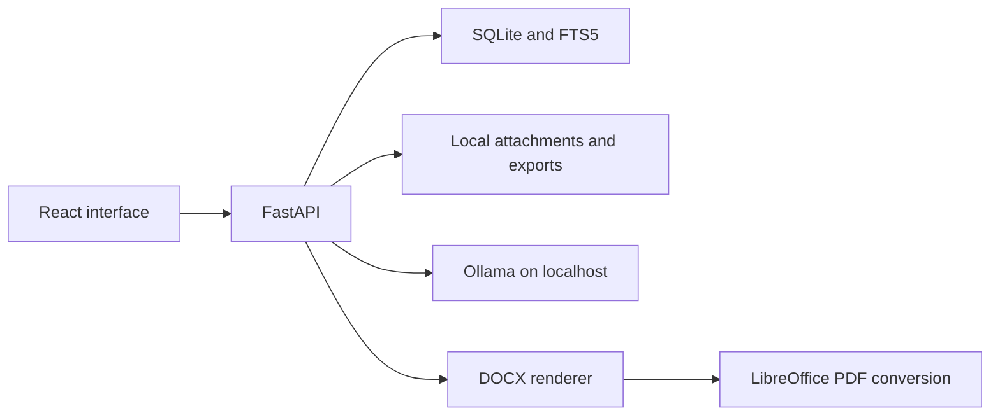

# Local Resume Tailoring App Build Guide

## Purpose and product principle

Build a local-first application that keeps a structured library of your work and uses it to create resumes tailored to individual job descriptions. Every resume claim must link to evidence that you entered and verified. AI may find relevant evidence and suggest wording; it must not invent employers, skills, responsibilities, dates, results, or metrics.

The first release should cover the complete core workflow: career evidence library, job description analysis, evidence matching, resume drafting, ATS readiness checks, DOCX/PDF export, and application tracking. Browser-based application assistance is a later milestone and must stop before final submission.

## 1. Product requirements

### Main user journey

1. Add work experiences, projects, skills, achievements, metrics, and reusable bullets.
2. Attach a source or note to each achievement and mark it verified.
3. Paste a job description and review extracted requirements.
4. See verified evidence that supports each requirement and gaps where none exists.
5. Select evidence and draft a tailored resume.
6. Review every suggested bullet with its source evidence.
7. Run keyword and formatting checks on the exported document.
8. Save the resume version and track the application.

### Functional requirements

- Add, edit, search, archive, and export career records.
- Link skills and metrics to the project or experience where they were demonstrated.
- Preserve the original job description and let the user edit extracted requirements.
- Distinguish direct evidence, related evidence, and unsupported requirements.
- Generate resume bullets only from verified evidence; retain source links in the editor.
- Save immutable resume snapshots for each job application.
- Export DOCX and PDF, then check text extraction from both files.
- Track employer, role, URL, status, dates, notes, events, and the resume version used.
- Work without AI; AI features should be optional and local through Ollama.
- Store the database, attachments, and exports locally by default.

## 2. Recommended architecture

Use a React + TypeScript interface, a Python FastAPI backend, and SQLite for the single-user MVP. The API owns validation and business rules. Keep matching, evidence validation, ATS checks, and document generation in backend services that can be tested without the UI.



Suggested project structure:

```text
resume-app/
  backend/app/{api,models,schemas,services,templates}/
  backend/tests/
  backend/migrations/
  frontend/src/{pages,components,api}/
  data/{attachments,exports}/
  compose.yaml
  .env.example
  README.md
```

SQLite FTS5 is sufficient for searching a personal career library. Add semantic embeddings only after lexical search has been tested and real misses are understood. Move to PostgreSQL only if you need multiple users or shared access across machines.

## 3. Technology choices

| Purpose | MVP choice | Alternative |
|---|---|---|
| UI | React, TypeScript, Vite | Vue or Svelte |
| API | FastAPI, Pydantic | Django for its built-in admin |
| Database | SQLite, SQLAlchemy, Alembic | PostgreSQL for shared multi-user use |
| Search | SQLite FTS5 and skill aliases | PostgreSQL full-text search |
| Local model runtime | Ollama | llama.cpp |
| DOCX | python-docx and controlled templates | LibreOffice-driven templates |
| PDF | Convert DOCX with LibreOffice | HTML-to-PDF renderer |
| Browser automation later | Playwright with a visible browser | Manual browser handoff |
| Tests | pytest, Vitest | Playwright end-to-end tests |

Check the license of the specific model weights you install. The model and runtime can have different licenses. Do not depend on a cloud API for the core product.

## 4. Database schema

Use UUIDs or ULIDs, UTC timestamps, migrations, foreign keys, and archive fields. Keep exported resume snapshots immutable so that later edits to career records cannot change what a past application used.

| Table | Important fields | Purpose |
|---|---|---|
| `profile` | name, email, phone, location, links | Contact details |
| `organizations` | name, industry, URL | Employers and clients |
| `experiences` | organization, title, dates, location, description | Employment and volunteer roles |
| `projects` | experience link, name, summary, dates, URL | Work and personal projects |
| `skills` | name, canonical name, category | Normalized skill list |
| `skill_aliases` | skill ID, alias | Map equivalents such as Postgres/PostgreSQL |
| `evidence_items` | claim, experience/project link, source note, verification state | Atomic, traceable accomplishments |
| `evidence_skills` | evidence ID, skill ID | Skills demonstrated by evidence |
| `metrics` | evidence ID, name, value, unit, context, source | Numbers and their meaning |
| `bullet_variants` | evidence ID, text, tone, approved date | Reusable resume wording |
| `attachments` | evidence ID, relative path, type, checksum | Supporting documents |
| `jobs` | company, title, URL, raw description, source | Job postings |
| `job_requirements` | job ID, text, normalized term, kind, priority, confirmed | Extracted requirements |
| `requirement_matches` | requirement ID, evidence ID, status, reason, method | Match decisions |
| `resumes` | job ID, name, status | A targeted resume |
| `resume_versions` | resume ID, version number, content JSON, template, approval date | Immutable resume snapshot |
| `resume_bullets` | version ID, evidence ID, text, order | Output-to-evidence links |
| `export_files` | version ID, format, relative path, checksum | DOCX and PDF artifacts |
| `applications` | job ID, resume version, status, dates, notes | Application tracker |
| `application_events` | application ID, event type, time, note | Status history |

Use `draft`, `verified`, and `rejected` as evidence states. Enforce at the service layer and database boundary that approved bullets only use verified evidence. Store attachment and export paths relative to one configured data directory.

## 5. API design

Prefix endpoints with `/api/v1`; define request and response schemas with Pydantic.

| Endpoint | Methods | Purpose |
|---|---|---|
| `/profile` | GET, PUT | Read/update profile |
| `/experiences`, `/projects`, `/skills`, `/evidence` | GET, POST | List and create records |
| `/{collection}/{id}` | GET, PATCH | Read or update one record |
| `/jobs` | GET, POST | List jobs or save pasted description |
| `/jobs/{id}/analyze` | POST | Extract draft requirements |
| `/jobs/{id}/requirements` | GET, PATCH | Review and edit requirements |
| `/jobs/{id}/matches` | POST | Find matching verified evidence |
| `/resumes` | GET, POST | List or create targeted resume |
| `/resumes/{id}/draft` | POST | Create a proposed version |
| `/resume-versions/{id}` | GET, PATCH | Review/edit a saved version |
| `/resume-versions/{id}/ats` | POST | Analyze draft or exported text |
| `/resume-versions/{id}/export` | POST | Generate DOCX and PDF |
| `/applications` | GET, POST | List or create applications |
| `/applications/{id}` | GET, PATCH | Update status and notes |
| `/backup/export`, `/backup/import` | POST | Portable backup and validated restore |

Every match response should include the requirement, status, evidence IDs, evidence text, and a short explanation. The UI must not guess whether evidence is verified; the API returns that status explicitly.

## 6. Frontend pages

1. **Dashboard:** recent jobs, resumes, applications, and incomplete evidence.
2. **Career library:** searchable experiences, projects, skills, and claims.
3. **Evidence editor:** claim, source, metric, linked project/job, skill tags, verification state, bullet variants.
4. **Job workspace:** original description beside extracted requirements.
5. **Match review:** requirements with evidence links or visible gaps.
6. **Resume editor:** sections, selected bullets, source links, preview, and version history.
7. **ATS report:** keyword statuses, formatting checks, and extracted-text preview.
8. **Applications:** list/board, status history, notes, linked resume version.
9. **Settings:** data folder, Ollama endpoint/model, backups, and templates.

## 7. AI workflows and prompts

AI is optional and bounded. Use Ollama structured outputs with a JSON schema, then validate the result in Python. For each job, preserve the raw description and allow the user to correct model extraction.

### Requirement extraction

```text
Extract requirements explicitly stated in this job description.
Return JSON matching the supplied schema. For every requirement, include the
exact supporting text span, category (skill, tool, responsibility, experience,
education, certification), priority (required, preferred, unclear), and
confidence. Do not infer unstated requirements.
```

Reject any extracted item whose cited span does not occur in the original text.

### Matching

Retrieve candidates using exact terms, canonical skill names, aliases, and FTS5 first. Optionally ask the model to classify a small candidate set:

```text
Compare this requirement with the supplied evidence items. Classify each as
direct, related, or unsupported. Use only the supplied evidence. Explain each
classification briefly. Return evidence IDs; do not rewrite the claims.
```

Semantic similarity is only a retrieval hint, not proof. The user confirms related matches before using them.

### Bullet drafting

```text
Rewrite this verified evidence as one concise resume bullet. Preserve the
actor, action, tools, scope, outcome, and numeric values. Do not add a skill,
employer, date, metric, result, or ownership level absent from the evidence.
Return the bullet and evidence ID. If evidence is insufficient, return
"insufficient_evidence".
```

After generation, verify all evidence IDs are verified; compare numbers, dates, employers, and named technologies against source records; and require user review. If the model is unavailable or returns invalid JSON, preserve edits and fall back to deterministic matching and saved bullet variants.

## 8. ATS readiness analysis

Describe this as an ATS readiness report, not a prediction of an employer’s score. Systems and employer configurations vary.

1. Use user-confirmed requirements, not unreviewed model output.
2. Normalize case, punctuation, common pluralization, and approved aliases.
3. Check exact phrases separately from related concepts.
4. Analyze text extracted from the exported DOCX and PDF, not only editor state.
5. Label each requirement `present_exact`, `present_alias`, `supported_but_missing_from_resume`, or `no_verified_evidence`.
6. Suggest wording only when verified evidence supports it.
7. Show which terms are missing and display extracted text for review.

Formatting checks should confirm that contact details and headings extract correctly, bullets remain selectable and in sensible reading order, dates remain associated with roles, no key content is only an image, symbols are not garbled, and the document stays within the chosen page target. Start with a simple single-column template.

## 9. Resume generation workflow

1. Save the original job description.
2. Extract requirements and let the user confirm them.
3. Retrieve relevant verified evidence.
4. Let the user select projects, experiences, and bullets.
5. Generate bullet wording from the selected evidence.
6. Display each bullet with its underlying claim and metric.
7. Let the user edit and approve the resume.
8. Save an immutable resume version.
9. Render DOCX and convert it to PDF.
10. Extract text from both exports and run ATS checks.
11. Link files and resume version to the application.

Store the resume section structure as JSON for convenient editing, and keep relational bullet-to-evidence links for validation and traceability.

## 10. Security and privacy

- Bind to `127.0.0.1` by default; this is a personal local app.
- Keep database, attachments, and exports in a configurable local data directory.
- Do not send resume data to cloud AI by default; show the configured Ollama endpoint.
- Validate upload size, type, extension, and file content.
- Prevent path traversal and sanitize imported HTML before display.
- Add timeouts and restrictions if URL fetching is introduced.
- Exclude personal data, local databases, and generated exports from Git.
- Provide a full data export and validated backup restore.
- Explain that ordinary backups contain personal data; encryption can be added after MVP.
- Do not store job-site passwords. Browser assistance uses a visible session and requires user confirmation before any final submission.

## 11. Testing strategy

Test the rules that protect accuracy:

- **Unit:** aliases, normalization, matching statuses, rejected unverified claims, metric preservation.
- **Database:** migrations, foreign keys, archiving, immutable resume versions.
- **API:** request validation, analysis, export errors, backup/restore.
- **Documents:** DOCX and PDF open and contain approved text in the expected order.
- **End to end:** enter evidence → analyze job → review matches → draft → export → track application.
- **Manual:** inspect exports in a document viewer and test representative job descriptions.

Create fixtures with direct matches, related matches, and tempting unsupported keywords. The critical acceptance test: unsupported keywords cannot enter an approved resume through generation.

## 12. Local development and Docker

Use SQLite in a mounted local data directory. Run Ollama on the host or as a separate service. Example configuration:

```text
DATABASE_URL=sqlite:////data/resume.db
DATA_DIR=/data
OLLAMA_BASE_URL=http://host.docker.internal:11434
OLLAMA_CHAT_MODEL=<installed-model-tag>
APP_HOST=127.0.0.1
APP_PORT=8000
```

Initial developer setup:

```bash
# Backend
python -m venv .venv
pip install -r backend/requirements.txt
alembic upgrade head
uvicorn app.main:app --reload

# Frontend
npm install
npm run dev

# Optional local AI, after Ollama is installed
ollama pull qwen3.5:9b
```

Compose should define API and web services, mount `./data` into the API, and bind ports to localhost. If the API container generates PDFs, install LibreOffice and fonts in that image. Keep the database and exports in persistent storage.

The development machine reports Python 3.15.0, which may be ahead of library support. Before choosing the project runtime, check package compatibility and use a stable supported Python release if dependencies do not support 3.15.

## 13. Milestones, tasks, and definitions of done

### Milestone 1: Foundation

**Tasks:** scaffold React/Vite and FastAPI; add linting, type checks, and test runners; configure local data directory; add SQLite, SQLAlchemy, Alembic, and initial migration; add `/health`; create frontend shell, `.env.example`, `.gitignore`, and setup instructions.

**Done:** a clean checkout starts locally, migration creates the database, health endpoint responds, and frontend loads.

### Milestone 2: Career evidence library

**Tasks:** implement profile, experience, project, skill, evidence, metric, and bullet-variant models; add CRUD and validation; build library and editor pages; add verification and source notes; add FTS5 search, skill aliases, and JSON export.

**Done:** real work can be entered, searched, linked to skills and metrics, and verified. Archiving a source record does not change existing resume versions.

### Milestone 3: Job descriptions and matching

**Tasks:** implement jobs and requirements; add paste/review UI; extract obvious terms deterministically; add optional Ollama JSON extraction; implement evidence retrieval and statuses; build requirement and match review pages.

**Done:** pasted descriptions produce editable requirements, every match links to evidence, and unsupported requirements are clear.

### Milestone 4: Resume drafting

**Tasks:** define sections and immutable versions; add content selection and ordering; draft bullets from verified evidence; validate evidence IDs, tools, dates, and metrics; build editor with source links and version history.

**Done:** every proposed bullet has a verified source; unsupported claims are blocked; approved versions are saved as snapshots.

### Milestone 5: Export and ATS report

**Tasks:** build a single-column DOCX template; render approved versions; convert DOCX to PDF with LibreOffice; extract text from both; implement keyword and formatting checks; display report and extracted-text preview.

**Done:** both files open, important text extracts in order, and the report separates wording gaps from evidence gaps.

### Milestone 6: Application tracker and backup

**Tasks:** implement applications and events; build list/detail screens; link jobs, versions, and exports; add statuses, dates, notes, and follow-ups; export and restore validated backups.

**Done:** an application points to the exact resume version used, and a backup restores data and attachments in a clean installation.

### Milestone 7: Semantic search

**Tasks:** add configurable local embeddings; index verified evidence; combine lexical and semantic retrieval; explain rankings; benchmark against fixtures and real examples; retain deterministic fallback.

**Done:** semantic search finds relevant evidence missed by exact search without promoting unsupported claims.

### Milestone 8: Browser application assistant

**Tasks:** open saved job pages in a visible browser; detect supported fields; map only approved profile/application data; show a field-by-field fill plan; fill supported fields and attach selected resume; stop at final review; record outcome after user confirmation.

**Done:** supported forms can be prepared with review, final submission remains a deliberate user action, and failures do not lose the draft or application state.

## 14. Recommended build order

Complete Milestones 1–6 for a useful first release. Add semantic search and browser assistance only after evidence-backed drafting, export, and tracking work reliably. Build and test one vertical slice at a time rather than generating the entire application in one pass.

## Learning and resume readiness

For each feature, first explain its behavior in your own words, ask the coding assistant to describe the data flow, implement one small slice, trace a request through UI/API/database, and test one failure case. Keep a learning log with your decisions, bugs fixed, tradeoffs, and measurements. Only claim technologies and results you personally understand and can describe accurately; add metrics after measuring them.

## Model choice for building

Use **GPT-6 Astra** with high reasoning for the initial architecture and full build guide. Use **GPT-6.1 Sol** as the everyday coding partner for implementing milestones and reviewing changes. Use **GPT-6 Luna** for small, well-defined edits. Model availability depends on the account and model picker.

## Official references

- SQLite FTS5: https://www.sqlite.org/fts5.html
- Ollama structured outputs: https://docs.ollama.com/capabilities/structured-outputs
- Ollama embeddings: https://docs.ollama.com/capabilities/embeddings
- Ollama Qwen 3.5 model listing: https://ollama.com/library/qwen3.5
- FastAPI SQL database tutorial: https://fastapi.tiangolo.com/tutorial/sql-databases/
- Playwright Python: https://playwright.dev/python/docs/intro
- python-docx: https://python-docx.readthedocs.io/en/latest/user/documents.html
- LibreOffice PDF conversion: https://help.libreoffice.org/latest/en-US/text/shared/guide/pdf_params.html
- OpenAI model selection: https://developers.openai.com/api/docs/guides/model-selection
